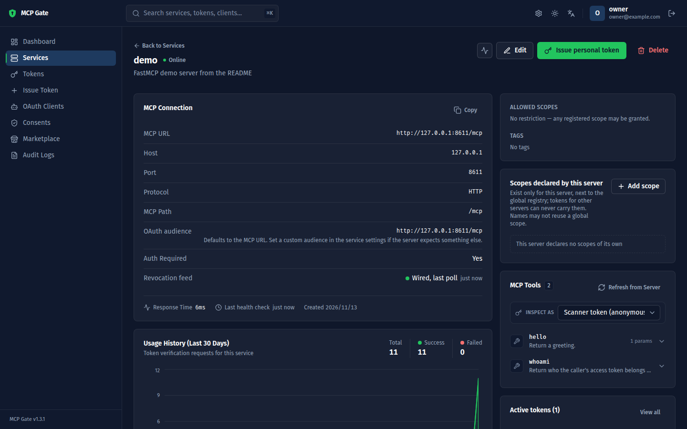

# MCP Gate

[](LICENSE)
[](https://github.com/xianhong1208/MCP_Gate/actions/workflows/ci.yml)
[](https://github.com/xianhong1208/MCP_Gate/releases/latest)

**Sign-in, tokens and a console for the MCP servers you run: an open-source OAuth 2.1 authorization server built for the Model Context Protocol.**

[繁體中文](README.zh-TW.md) · [Reference](docs/reference.md) · [Deploy](docs/deploy.md) · [Roadmap](ROADMAP.md) · [Changelog](CHANGELOG.md)



MCP Gate puts standards-based authentication in front of every MCP server you run. A [FastMCP](https://gofastmcp.com) server is protected with a few lines, MCP clients such as Claude Code, Claude Desktop and Cursor connect through the OAuth flow they already implement, and scripts use personal access tokens. Your servers verify tokens offline against MCP Gate's public keys; MCP Gate is never on the request path.

## What's new

**1.3.1** (2026-11-09): signing in from the consent screen returns to the authorization request, and two services can no longer share one audience. 1.3.0 added a one-time setup token for the first owner and a dependency audit in CI. See the [changelog](CHANGELOG.md) for every release, and the [roadmap](ROADMAP.md) for what comes next.

## Key features

- **A standards-based authorization server.** Covers the authorization part of the [MCP specification](https://modelcontextprotocol.io/specification/2025-06-18/basic/authorization): RFC 8414 metadata, RFC 7591 dynamic client registration, Client ID Metadata Documents (the registration method of MCP 2026-07-28), authorization code + PKCE, refresh-token rotation with replay detection, RFC 7009 revocation, RFC 7662 introspection, RFC 8707 resource indicators, RFC 9207 `iss`, and `private_key_jwt` client authentication.
- **Offline verification.** RS256 tokens bound to each server's audience, so a token for one server never works on another. Servers fetch the JWKS once and verify locally.
- **Revocation that reaches offline verifiers.** A server polls the revocation feed and refuses a revoked token within seconds, personal access tokens included, without calling MCP Gate per request.
- **A consent screen** for clients that register themselves, with decisions remembered per client and server.
- **Personal access tokens** for scripts, CI and clients without OAuth, with ready-to-paste `claude mcp add` and `mcpServers` snippets.
- **A server registry.** Register or scan MCP servers, sync their tools, watch their health, and see each tool list as a given token sees it ("Inspect as").
- **Marketplace and orchestrator.** Deploy MCP servers from a catalog, or paste a `{command, args, env}` block and let MCP Gate run it in Docker or as a local process behind an HTTP bridge.
- **Zero-config start.** SQLite by default, secrets generated on first run, an in-browser setup for the owner account; PostgreSQL is one environment variable away. The console speaks English and Traditional Chinese.

## Installation

You need Python 3.11 or later and [uv](https://docs.astral.sh/uv/). Docker is needed only for the Marketplace.

```bash
git clone https://github.com/xianhong1208/MCP_Gate.git
cd MCP_Gate
uv sync
cp .env.example .env      # optional: every setting has a working default
uv run python main.py
```

The startup log says where everything is:

```
  Version:    1.3.1
  Address:    http://0.0.0.0:4568
  Issuer:     http://localhost:4568
  Database:   sqlite:///data/mcp_gate.db
  Metadata:   http://localhost:4568/.well-known/oauth-authorization-server
  JWKS:       http://localhost:4568/.well-known/jwks.json
  No admin account yet → open http://localhost:4568/setup to create the owner
  Setup token: 7Qw…  (also in data/secrets.json as SETUP_TOKEN; it stops working once the owner exists)
```

Open <http://localhost:4568/setup>, paste the **setup token** from the log and create the owner account. (Or set `ADMIN_EMAIL` and `ADMIN_PASSWORD` before the first start.)

> **Not on `localhost`?** Set `OAUTH_ISSUER` to the public URL (for example `https://mcp.example.com`) before you issue any tokens. It is written into every token, and changing it later invalidates them all. See [Deploy](docs/deploy.md).

## Quick start

This walk-through protects a FastMCP server with MCP Gate, calls it with a personal access token, and turns on the revocation feed. It assumes MCP Gate at `http://localhost:4568` and the server at `http://127.0.0.1:8000/mcp`.

### 1. Register the server

In the console, open **Services → Register Service** and enter host `127.0.0.1`, port `8000` and path `/mcp`. The server's **audience**, the URL its tokens are valid for, defaults to its MCP URL: `http://127.0.0.1:8000/mcp`. Register first: MCP Gate only issues tokens for audiences it knows.

### 2. (Optional) Register a client for the revocation feed

On its own, a server that verifies offline keeps accepting a revoked token until it expires. To have it refuse revoked tokens within seconds, open **OAuth Clients → Register trusted client** and choose:

- grant type `client_credentials` only, no redirect URIs;
- authentication *Client secret*;
- **Resource server for**: the server you registered in step 1.

Copy the client id and secret; the secret is shown once. Skip this step and the example below runs without the feed.

### 3. Write the server

Copy [`examples/mcp_gate_hooks.py`](examples/mcp_gate_hooks.py) next to your server. It holds `MCPGateVerifier`, FastMCP's `JWTVerifier` plus the revocation feed and usage reports, and needs only `fastmcp` and `httpx`. Then save this as `server.py` (it is [`examples/fastmcp_server_hooks.py`](examples/fastmcp_server_hooks.py)):

```python
"""A FastMCP server protected by MCP Gate, with the revocation feed.

Every request must carry an access token issued by MCP Gate for this server's audience. Tokens are verified
offline against MCP Gate's JWKS; MCP Gate is never on the request path. When a resource-server client is
configured (MCP_GATE_CLIENT_ID / MCP_GATE_CLIENT_SECRET), MCPGateVerifier also polls MCP Gate's revocation
feed, so a revoked token is refused within `poll_interval` seconds, and reports token usage to the console.

    pip install fastmcp httpx          # or: uv add fastmcp httpx
    cp examples/mcp_gate_hooks.py .    # MCPGateVerifier lives in that single file
    MCP_GATE_URL=http://localhost:4568 python server.py

Before starting it, register the server in the MCP Gate console (Services -> Register Service: host
127.0.0.1, port 8000, path /mcp), so its audience is http://127.0.0.1:8000/mcp. For the revocation feed,
also register a confidential client with grant type client_credentials and "Resource server for" set to
this server, and export its id and secret. See the README's Quick start.
"""

import os

from fastmcp import FastMCP
from fastmcp.server.auth import RemoteAuthProvider
from fastmcp.server.auth.providers.jwt import JWTVerifier
from fastmcp.server.dependencies import get_access_token

from mcp_gate_hooks import MCPGateVerifier

MCP_GATE = os.environ.get("MCP_GATE_URL", "http://localhost:4568").rstrip("/")  # MCP Gate's OAUTH_ISSUER
HOST = os.environ.get("MCP_HOST", "127.0.0.1")
PORT = int(os.environ.get("MCP_PORT", "8000"))
BASE_URL = f"http://{HOST}:{PORT}"
AUDIENCE = os.environ.get("MCP_AUDIENCE", f"{BASE_URL}/mcp")  # must equal the audience shown in the console

verifier_settings = dict(
    jwks_uri=f"{MCP_GATE}/.well-known/jwks.json",
    issuer=MCP_GATE,
    audience=AUDIENCE,
    required_scopes=["mcp:tools:invoke"],
)

if os.environ.get("MCP_GATE_CLIENT_ID"):
    # Offline verification plus the revocation feed and usage reports.
    verifier = MCPGateVerifier(
        **verifier_settings,
        client_id=os.environ["MCP_GATE_CLIENT_ID"],
        client_secret=os.environ["MCP_GATE_CLIENT_SECRET"],
        poll_interval=15,   # seconds between revocation-feed polls
        flush_interval=30,  # seconds between usage reports
    )
else:
    # Offline verification only: a revoked token keeps working until it expires.
    verifier = JWTVerifier(**verifier_settings)

auth = RemoteAuthProvider(
    token_verifier=verifier,
    authorization_servers=[MCP_GATE],  # served at /.well-known/oauth-protected-resource for OAuth clients
    base_url=BASE_URL,
)

mcp = FastMCP(name="demo", instructions="A demo server protected by MCP Gate", auth=auth)


@mcp.tool
def hello(name: str) -> str:
    """Return a greeting."""
    return f"Hello, {name}!"


@mcp.tool
def whoami() -> dict:
    """Return who the caller's access token belongs to."""
    token = get_access_token()
    return {
        "subject": token.subject if token else None,
        "client_id": token.client_id if token else None,
        "scopes": token.scopes if token else [],
    }


if __name__ == "__main__":
    revocation = "on" if isinstance(verifier, MCPGateVerifier) else "off"
    print(f"MCP Gate: {MCP_GATE}   audience: {AUDIENCE}   revocation feed: {revocation}")
    mcp.run(transport="http", host=HOST, port=PORT)
```

### 4. Run it

```bash
pip install fastmcp httpx                    # or: uv add fastmcp httpx
export MCP_GATE_URL=http://localhost:4568    # MCP Gate's OAUTH_ISSUER
export MCP_GATE_CLIENT_ID=mcpc_…             # from step 2; leave both unset to run without the feed
export MCP_GATE_CLIENT_SECRET=…
python server.py
```

It prints `MCP Gate: http://localhost:4568   audience: http://127.0.0.1:8000/mcp   revocation feed: on`. Within a few seconds the server's page in the console shows **Revocation feed: Wired**.

### 5. Call it with a personal access token

In the console, open **Issue Token**, choose the server, give the token a label and copy it (it is shown once). Then:

```python
import asyncio
import os

from fastmcp import Client
from fastmcp.client.auth import BearerAuth


async def main():
    pat = os.environ["MCP_GATE_PAT"]  # a personal access token issued for this server
    async with Client("http://127.0.0.1:8000/mcp", auth=BearerAuth(pat)) as client:
        print([tool.name for tool in await client.list_tools()])
        print((await client.call_tool("hello", {"name": "MCP Gate"})).data)
        print((await client.call_tool("whoami", {})).data)


asyncio.run(main())
```

```
['hello', 'whoami']
Hello, MCP Gate!
{'subject': '…', 'client_id': 'mcp-gate-console', 'scopes': ['mcp:prompts:read', 'mcp:resources:read', 'mcp:tools:invoke', 'mcp:tools:read']}
```

Without a token the server answers `401` and points the client at MCP Gate:

```bash
curl -i -X POST http://127.0.0.1:8000/mcp \
  -H 'Content-Type: application/json' -H 'Accept: application/json, text/event-stream' \
  -d '{"jsonrpc":"2.0","id":1,"method":"tools/list"}'
# HTTP/1.1 401 Unauthorized
# www-authenticate: Bearer scope="mcp:tools:invoke", resource_metadata="http://127.0.0.1:8000/.well-known/oauth-protected-resource/mcp"
```

Revoke the token in the console (**Tokens → Revoke**) and, with the feed on, the next call is refused within one poll interval (15 seconds in the example).

### 6. Connect an MCP client

Clients that speak OAuth need nothing up front. On first use they register with MCP Gate and open the consent screen in your browser:

```bash
claude mcp add --transport http demo http://127.0.0.1:8000/mcp
```

Clients without OAuth take the personal access token as a header:

```bash
claude mcp add --transport http demo http://127.0.0.1:8000/mcp \
  --header "Authorization: Bearer <PERSONAL_ACCESS_TOKEN>"
```

The **Integration** panel on each server's page generates these snippets, and the server code, for that server's own URL and audience.

## How it works

```
┌──────────────────────┐   ① 401 + protected-resource metadata   ┌──────────────────────┐
│      MCP client      │ ───────────────────────────────────────▶ │   your FastMCP server │
│ Claude Code / Cursor │ ◀─────────────────────────────────────── │   (resource server)   │
│  Claude Desktop / …  │   ⑤ Authorization: Bearer <JWT>          │                      │
└──────────┬───────────┘                                          └──────────┬───────────┘
           │ ② discovery + dynamic client registration                       │ ④ fetch JWKS once,
           │ ③ authorize (PKCE) → consent → code → token                     │    verify offline;
           ▼                                                                 ▼    poll revocations
┌──────────────────────────────────────────────────────────────────────────────────────────┐
│  MCP Gate — OAuth 2.1 authorization server + console                                    │
│  /.well-known/oauth-authorization-server   /.well-known/jwks.json   /oauth/revoked       │
│  /oauth/register  /oauth/authorize  /oauth/token  /oauth/revoke  /oauth/introspect       │
└──────────────────────────────────────────────────────────────────────────────────────────┘
```

MCP Gate is the **authorization server**; your MCP servers are **resource servers** that verify tokens and never issue them. The [reference](docs/reference.md) covers each step, the token claims, every setting, Client ID Metadata Documents, the revocation feed, the console pages and the HTTP API.

## Deployment options

| Where | How |
|---|---|
| Your machine | `uv run python main.py`, SQLite in `data/`. The default issuer is `http://localhost:4568`. |
| A server, behind HTTPS | A reverse proxy (nginx or Caddy) in front, `OAUTH_ISSUER` set to the public URL, `SECURE_COOKIE=true`: see [Deploy](docs/deploy.md). |
| PostgreSQL | `uv sync --extra postgres` and `DATABASE_URL=postgresql://…`. Migrations run at every start. |

An official Docker image is planned for 1.4 (see the [roadmap](ROADMAP.md)).

## Documentation

- [Reference](docs/reference.md): how it works, configuration, revocation feed, console, API
- [Deploy behind a reverse proxy with HTTPS](docs/deploy.md)
- [Troubleshooting](docs/troubleshooting.md)
- [Architecture](docs/architecture.md)
- [Security policy](SECURITY.md)
- [Roadmap](ROADMAP.md) · [Changelog](CHANGELOG.md)

## Contributing

Issues and pull requests are welcome. [CONTRIBUTING.md](CONTRIBUTING.md) covers the development setup, the checks CI runs, the layering rule and the release steps.

## Licence

[MIT](LICENSE)
