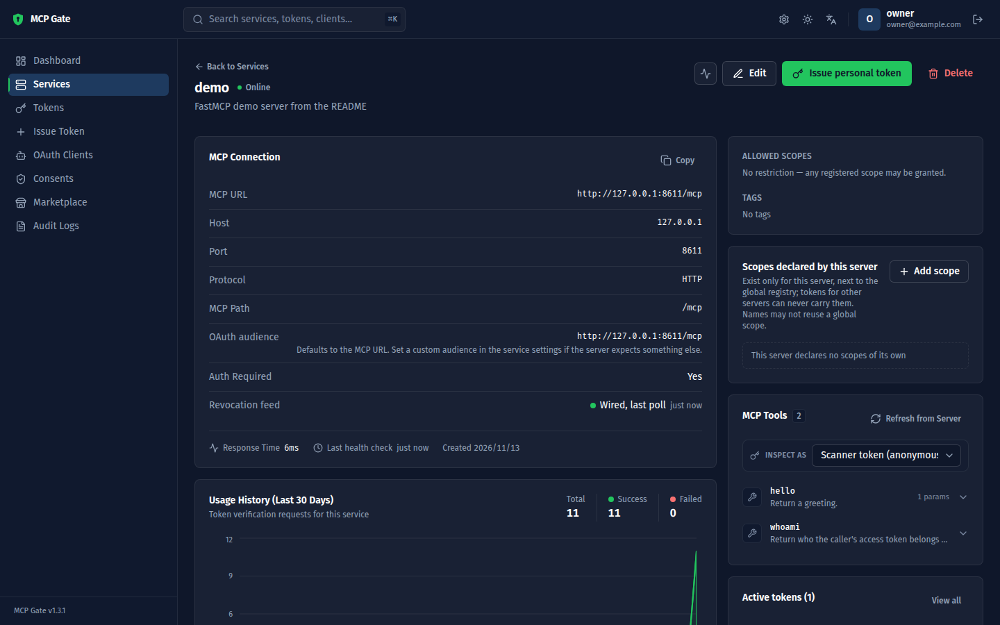

# MCP Gate

[](LICENSE)
[](https://github.com/xianhong1208/MCP_Gate/actions/workflows/ci.yml)
[](https://github.com/xianhong1208/MCP_Gate/releases/latest)

**替你自己架的 MCP server 管登入、token 與管理台:專為 Model Context Protocol 打造的開源 OAuth 2.1 授權伺服器。**

[English](README.md) · [參考資料](docs/reference.zh-TW.md) · [部署](docs/deploy.md) · [發展路線圖](ROADMAP.zh-TW.md) · [變更紀錄](CHANGELOG.md)



MCP Gate 把標準化的身分驗證放在你每一台 MCP server 前面。[FastMCP](https://gofastmcp.com) server 加幾行就受到保護;Claude Code、Claude Desktop、Cursor 這類 MCP client 直接用它們內建的 OAuth 流程連上,腳本則用 personal access token。server 拿 MCP Gate 的公鑰在本地驗 token,MCP Gate 不在請求路徑上。

## 最新消息

**1.3.1**(2026-11-09):從同意頁登入後會回到原本的授權請求,兩個服務也不能再共用同一個 audience。1.3.0 為第一位擁有者加上一次性設定碼,並在 CI 加入相依套件稽核。各版本內容見[變更紀錄](CHANGELOG.md),接下來的方向見[發展路線圖](ROADMAP.zh-TW.md)。

## 主要特色

- **標準化的授權伺服器。** 涵蓋 [MCP 規範](https://modelcontextprotocol.io/specification/2026-07-28/basic/authorization)(2026-07-28)的授權部分:RFC 8414 metadata、Client ID Metadata Documents(建議的註冊方式)、RFC 7591 動態註冊(規範已列為棄用,仍支援)、authorization code + PKCE、refresh token 輪替與重放偵測、RFC 7009 撤銷、RFC 7662 內省、RFC 8707 resource indicator、RFC 9207 `iss`,以及 `private_key_jwt` client 驗證。
- **離線驗證。** RS256 token 綁定每台 server 的 audience,給 A 的 token 永遠不能打 B。server 只抓一次 JWKS,之後在本地驗證。簽章金鑰每 90 天自動輪替,新金鑰在開始簽發前一天先公開;外洩的金鑰可以在管理台撤銷,`ENCRYPTION_KEY` 也能用一個指令輪替。
- **撤銷也傳得到離線驗證的 server。** server 輪詢撤銷清單,幾秒內就拒絕已撤銷的 token(PAT 也算在內),不必每個請求都問 MCP Gate。
- **同意頁**:自行註冊的 client 第一次連線要你按允許,可依 client 與 server 記住決定。
- **一步連上 client。** 每台 server 頁面都有 Claude Code、Cursor、VS Code 與 Codex 的現成設定(指令、可複製或下載的設定檔、Cursor 一鍵安裝連結),預設透過 MCP Gate 登入。見[連上 client](#6-連上-client)。
- **Personal access token(PAT)**:給腳本、CI 與沒有瀏覽器的機器;client 片段從環境變數讀取它,永遠不寫進設定檔。
- **服務登錄。** 手動登記或掃描 MCP server、同步工具清單、監看健康狀態,還能用某張 token 的身分查看它看得到的工具(「Inspect as」)。支援 MCP 2026-07-28(`server/discover`、無狀態 server),遇到 2024-11-05 到 2025-11-25 的 server 則退回 `initialize` 握手;每個 server 的頁面會顯示它用哪一版回應。見 [MCP 協定版本](docs/reference.zh-TW.md#mcp-協定版本)。
- **Tool 釘選。** 每個 tool 定義都以 SHA-256 雜湊釘選;新的或變更過的 tool 要等管理員看過與已核准版本的差異後核准或拒絕。server 上的 FastMCP middleware 會隱藏所有未核准的 tool,並立刻回報新的 tool。見 [Tool 釘選與核准](docs/reference.zh-TW.md#tool-釘選與核准)。
- **Poisoning 掃描。** 內建規則會標示 tool 定義裡藏的指令、不可見字元、提到其他 server 的 tool、索取機密、可疑網址與編碼文字,並在核准卡片上標亮。不用模型、不連網;發現只供核准時參考,本身不會擋下任何東西。見 [Poisoning 掃描](docs/reference.zh-TW.md#poisoning-掃描)。
- **Tool 存取規則(1.6 進行中)。** 把 tool 放進 scope(工具組合),對個人存取 token、client、使用者或群組拒絕某些 tool,或限定只能用某些 tool;MCP Gate 會評估誰能呼叫什麼(先拒絕、再限定、再看 scope),同一個 FastMCP middleware 會在一次輪詢內於你的 server 上套用這些規則:被拒絕的 tool 會隱藏,需要 token 沒有的 scope 的 tool 會以 HTTP 403 `insufficient_scope` 拒絕(追加授權:Claude Code 會請你重新登入取得該 scope,再重試呼叫),錯誤訊息寫出所需的 scope。同意畫面會列出每個 scope 能使用的 tool,並標出新增的部分。管理台的每台 server 都有 **存取控制** 分頁,另有 **工具組合** 與 **群組** 頁可設定這些;server 的 middleware 太舊而無法執行時,管理台會提出警告。以某張 token 的身分 **Inspect as** 時，會顯示它能呼叫哪些 tool、其他的為什麼不行，並指出 server 自己列出的清單哪裡不一致；token 頁面會列出它能呼叫的 tool；**假設檢查** 表單可以在簽發任何東西之前，先檢查某個 client、使用者或群組成員加上額外 scopes 後的結果。見 [Tool 存取規則](docs/reference.zh-TW.md#tool-存取規則)。
- **Marketplace 與 orchestrator。** 從 catalog 部署 MCP server,或貼一段 `{command, args, env}`,由 MCP Gate 掛上 HTTP bridge,跑在 Docker 或本機行程裡。
- **零設定啟動。** 預設 SQLite、首次啟動自動產生密鑰、在瀏覽器裡建立擁有者帳號;換 PostgreSQL 只要一個環境變數。管理台有英文與繁體中文。

## 安裝

需要 Python 3.11 以上與 [uv](https://docs.astral.sh/uv/),或者只要有 Docker([用 Docker](#用-docker))。Marketplace 也需要 Docker。

```bash
git clone https://github.com/xianhong1208/MCP_Gate.git
cd MCP_Gate
uv sync
cp .env.example .env      # 可省略:所有設定都有可用的預設值
uv run python main.py
```

設定是環境變數(`.env`),由 `config/` 底下五個檔案讀取:`database.yaml`、`oauth.yaml`、`identity.yaml`、`security.yaml`、`system.yaml`。從 1.3(單一 `config.yaml`)升級:見[升級到 1.4](docs/reference.zh-TW.md#升級到-14)。

啟動 log 會告訴你每樣東西在哪裡:

```
  Version:    1.3.1
  Address:    http://0.0.0.0:4568
  Issuer:     http://localhost:4568
  Database:   sqlite:///data/mcp_gate.db
  Metadata:   http://localhost:4568/.well-known/oauth-authorization-server
  JWKS:       http://localhost:4568/.well-known/jwks.json
  No admin account yet → open http://localhost:4568/setup to create the owner
  Setup token: 7Qw…  (also in secrets/secrets.json as SETUP_TOKEN; it stops working once the owner exists)
```

打開 <http://localhost:4568/setup>,貼上 log 裡的**設定碼**並建立擁有者帳號。(也可以在第一次啟動前設好 `ADMIN_EMAIL` 與 `ADMIN_PASSWORD`。)

> **不是跑在 `localhost`?** 在簽發任何 token 之前,先把 `OAUTH_ISSUER` 設成公開網址(例如 `https://mcp.example.com`)。它會寫進每張 token,之後再改會讓所有 token 失效。見[部署](docs/deploy.md)。

### 用 Docker

官方 image 是 [`tonyhuang1101/mcp-gate`](https://hub.docker.com/r/tonyhuang1101/mcp-gate)(amd64 與 arm64,從 1.4.0 起每個版本一個 tag):

```bash
docker run -d --name mcp-gate -p 4568:4568 \
  -e OAUTH_ISSUER=http://localhost:4568 \
  -v mcp-gate-data:/app/data -v mcp-gate-secrets:/app/secrets \
  tonyhuang1101/mcp-gate:1.5.0
docker logs mcp-gate | grep "Setup token"
```

也可以用 repo 裡的 `docker-compose.yml` 執行 `docker compose up -d`(設定放 `.env`;加 `--profile postgres` 會多開 PostgreSQL;想用自己 checkout 的程式碼,把 `build: .` 取消註解)。`OAUTH_ISSUER` 必須是 client 連到這個容器時用的網址。資料庫和自動產生的密鑰各放一個 volume,請分開備份。log 用 `docker logs` 看;每次啟動都會跑 migration。volume、備份、升級與放在反向代理後面:見[部署 → Docker](docs/deploy.md#docker)。

## 快速開始

以下示範用 MCP Gate 保護一台 FastMCP server、用 personal access token 呼叫它,並開啟撤銷清單與 tool 核准。假設 MCP Gate 在 `http://localhost:4568`,server 在 `http://127.0.0.1:8000/mcp`。

### 1. 登記 server

在管理台打開 **Services → Register Service**,輸入 host `127.0.0.1`、port `8000`、path `/mcp`。server 的 **audience**(token 對哪個網址有效)預設就是它的 MCP URL:`http://127.0.0.1:8000/mcp`。一定要先登記:MCP Gate 只替它認得的 audience 簽 token。

### 2. (選用)為撤銷清單與 tool 核准登記 client

離線驗證的 server 單靠自己,會一直接受已撤銷的 token,直到它過期。要讓它在幾秒內拒絕,打開 **OAuth Clients → Register trusted client**,選:

- grant type 只勾 `client_credentials`,不填 redirect URI;
- 驗證方式 *Client secret*;
- **Resource server for**:步驟 1 登記的 server。

記下 client id 與 secret(secret 只顯示一次)。同一個 client 也會讀取這台 server 的 tool 核准狀態:有了它,server 只列出並執行你在管理台核准過的 tools。跳過這一步,下面的範例也能跑,只是兩者都沒有。

### 3. 寫 server

把 [`examples/mcp_gate_hooks.py`](examples/mcp_gate_hooks.py) 複製到 server 旁邊。裡面是 `MCPGateVerifier`:FastMCP 的 `JWTVerifier` 再加上撤銷清單與使用回報;以及 `MCPGateToolPinning`:一個 FastMCP middleware,會隱藏管理員還沒核准的 tools。只需要 `fastmcp` 和 `httpx`。接著把下面這段存成 `server.py`(就是 [`examples/fastmcp_server_hooks.py`](examples/fastmcp_server_hooks.py)):

```python
"""A FastMCP server protected by MCP Gate, with the revocation feed, tool approvals, tool access rules and step-up.

Every request must carry an access token issued by MCP Gate for this server's audience. Tokens are verified
offline against MCP Gate's JWKS; MCP Gate is never on the request path. When a resource-server client is
configured (MCP_GATE_CLIENT_ID / MCP_GATE_CLIENT_SECRET):

- MCPGateVerifier polls MCP Gate's revocation feed, so a revoked token is refused within `poll_interval`
  seconds, and reports token usage to the console;
- MCPGateToolPinning lists and runs only the tools an admin approved in the console. A new or changed tool is
  hidden at once and shows up in the console as pending. The approved list is cached in MCP_GATE_POLICY_CACHE,
  so a restart while MCP Gate is down keeps it; with no list at all every tool stays hidden.
- The same middleware applies the server's tool access rules to each token: a tool denied to the caller (or
  outside its "only these tools" rule) is hidden; a tool that needs a scope the token lacks is listed, and calling
  it fails with an error naming the scope. Rules set in the console reach the server within one poll.
- MCPGateScopeGate turns that refusal into a real HTTP 403 `insufficient_scope` challenge (step-up), so a client
  that supports it asks the user for the scope and retries; the error text names the scope either way.

    pip install fastmcp httpx          # or: uv add fastmcp httpx
    cp examples/mcp_gate_hooks.py .    # MCPGateVerifier, MCPGateToolPinning and MCPGateScopeGate: one file
    MCP_GATE_URL=http://localhost:4568 python server.py

Before starting it, register the server in the MCP Gate console (Services -> Register Service: host
127.0.0.1, port 8000, path /mcp), so its audience is http://127.0.0.1:8000/mcp. For the feeds, also register
a confidential client with grant type client_credentials and "Resource server for" set to this server, and
export its id and secret. See the README's Quick start.
"""

import os

from fastmcp import FastMCP
from fastmcp.server.auth import RemoteAuthProvider
from fastmcp.server.auth.providers.jwt import JWTVerifier
from fastmcp.server.dependencies import get_access_token
from starlette.middleware import Middleware

from mcp_gate_hooks import MCPGateScopeGate, MCPGateToolPinning, MCPGateVerifier

MCP_GATE = os.environ.get("MCP_GATE_URL", "http://localhost:4568").rstrip("/")  # MCP Gate's OAUTH_ISSUER
HOST = os.environ.get("MCP_HOST", "127.0.0.1")
PORT = int(os.environ.get("MCP_PORT", "8000"))
BASE_URL = f"http://{HOST}:{PORT}"
AUDIENCE = os.environ.get("MCP_AUDIENCE", f"{BASE_URL}/mcp")  # must equal the audience shown in the console

verifier_settings = dict(
    jwks_uri=f"{MCP_GATE}/.well-known/jwks.json",
    issuer=MCP_GATE,
    audience=AUDIENCE,
    required_scopes=["mcp:tools:invoke"],
)

middleware = []
pinning = None
if os.environ.get("MCP_GATE_CLIENT_ID"):
    # Offline verification plus the revocation feed and usage reports.
    verifier = MCPGateVerifier(
        **verifier_settings,
        client_id=os.environ["MCP_GATE_CLIENT_ID"],
        client_secret=os.environ["MCP_GATE_CLIENT_SECRET"],
        poll_interval=15,   # seconds between revocation-feed polls
        flush_interval=30,  # seconds between usage reports
    )
    # Only tools approved in the console are listed and callable, and the access rules apply to each token.
    pinning = MCPGateToolPinning(
        verifier,
        cache_file=os.environ.get("MCP_GATE_POLICY_CACHE", "mcp_gate_policy.json"),  # last approvals + rules
        poll_interval=15,   # seconds between tool-policy polls
        fail_open=False,    # True: list every tool until the first list arrives (default: hide them all)
    )
    middleware.append(pinning)
else:
    # Offline verification only: a revoked token keeps working until it expires, and every tool is listed.
    verifier = JWTVerifier(**verifier_settings)

auth = RemoteAuthProvider(
    token_verifier=verifier,
    authorization_servers=[MCP_GATE],  # served at /.well-known/oauth-protected-resource for OAuth clients
    base_url=BASE_URL,
)

mcp = FastMCP(name="demo", instructions="A demo server protected by MCP Gate", auth=auth, middleware=middleware)


@mcp.tool
def hello(name: str) -> str:
    """Return a greeting."""
    return f"Hello, {name}!"


@mcp.tool
def whoami() -> dict:
    """Return who the caller's access token belongs to."""
    token = get_access_token()
    return {
        "subject": token.subject if token else None,
        "client_id": token.client_id if token else None,
        "scopes": token.scopes if token else [],
    }


if __name__ == "__main__":
    feeds = "on" if isinstance(verifier, MCPGateVerifier) else "off"
    print(f"MCP Gate: {MCP_GATE}   audience: {AUDIENCE}   revocation feed: {feeds}   "
          f"tool approvals, access rules and step-up: {feeds}")
    # Serves MCP 2026-07-28 (stateless) and older clients on the same endpoint. Add stateless_http=True to keep no
    # sessions for older clients either (e.g. behind a load balancer); MCPGateVerifier and the middleware work both ways.
    # The step-up gate sits in front of FastMCP's HTTP handler (an ASGI middleware), next to the pinning middleware.
    http_middleware = [Middleware(
        MCPGateScopeGate,
        pinning=pinning,
        server=mcp,
        challenge_includes_token_scopes=False,  # True: also name the token's scopes, for clients that do not union
    )] if pinning else []
    mcp.run(transport="http", host=HOST, port=PORT, middleware=http_middleware)
```

### 4. 執行

```bash
pip install fastmcp httpx                    # 或:uv add fastmcp httpx
export MCP_GATE_URL=http://localhost:4568    # MCP Gate 的 OAUTH_ISSUER
export MCP_GATE_CLIENT_ID=mcpc_…             # 步驟 2 拿到的;兩個都不設就不開撤銷清單
export MCP_GATE_CLIENT_SECRET=…
python server.py
```

它會印出 `MCP Gate: http://localhost:4568   audience: http://127.0.0.1:8000/mcp   revocation feed: on   tool approvals, access rules and step-up: on`。幾秒內,管理台上這台 server 的頁面就會顯示 **Revocation feed: Wired** 與 **Tool approvals: Enforced by the server**,下方還有 **存取規則已執行**。

開啟 tool 核准後,新的 server 在你核准之前不會列出任何 tool。第一次有 client 列出 tools 時,server 會把 `hello` 和 `whoami` 回報給 MCP Gate,管理台上這台 server 的頁面就會顯示它們待核准、由 server 回報。看過定義後按 **Approve all**;一次輪詢之內(範例是 15 秒)兩個 tool 就會列出來。之後只要某個 tool 的名稱、說明或 schema 改變,它會立刻被隱藏,並附上與已核准版本的差異,等你再次核准。見 [Server 上的 tool 核准](docs/reference.zh-TW.md#server-上的-tool-核准)。

### 5. 用 personal access token 呼叫

在管理台打開 **Issue Token**,選這台 server、填一個標籤,複製 token(只顯示一次)。然後:

```python
import asyncio
import os

from fastmcp import Client
from fastmcp.client.auth import BearerAuth


async def main():
    pat = os.environ["MCP_GATE_PAT"]  # a personal access token issued for this server
    async with Client("http://127.0.0.1:8000/mcp", auth=BearerAuth(pat)) as client:
        print([tool.name for tool in await client.list_tools()])
        print((await client.call_tool("hello", {"name": "MCP Gate"})).data)
        print((await client.call_tool("whoami", {})).data)


asyncio.run(main())
```

```
['hello', 'whoami']
Hello, MCP Gate!
{'subject': '…', 'client_id': 'mcp-gate-console', 'scopes': ['mcp:prompts:read', 'mcp:resources:read', 'mcp:tools:invoke', 'mcp:tools:read']}
```

不帶 token,server 會回 `401`,並把 client 指向 MCP Gate:

```bash
curl -i -X POST http://127.0.0.1:8000/mcp \
  -H 'Content-Type: application/json' -H 'Accept: application/json, text/event-stream' \
  -d '{"jsonrpc":"2.0","id":1,"method":"tools/list"}'
# HTTP/1.1 401 Unauthorized
# www-authenticate: Bearer scope="mcp:tools:invoke", resource_metadata="http://127.0.0.1:8000/.well-known/oauth-protected-resource/mcp"
```

在管理台撤銷這張 token(**Tokens → Revoke**);開著撤銷清單時,下一次呼叫會在一個輪詢週期內被拒絕(範例是 15 秒)。

### 6. 連上 client

打開 server 頁面,使用 **連接用戶端**(或服務列表上的插頭圖示;列表上方的 **連接用戶端** 一次涵蓋所有 server)。它為 **Claude Code、Cursor、VS Code 與 Codex** 各有一個分頁,含指令、可複製或下載的設定檔與步驟,全部依那台 server 的 audience 產生。client 什麼都不用先做:第一次使用時會自己找到 MCP Gate、以 Client ID Metadata Document 表明身分(較舊的 client 則用動態註冊),並在瀏覽器開啟同意頁。以 Claude Code 為例:

```bash
claude mcp add --transport http demo http://127.0.0.1:8000/mcp
claude mcp login demo
```

Codex 一樣是 `codex mcp add demo --url http://127.0.0.1:8000/mcp` 與 `codex mcp login demo`;Cursor 有 **加入 Cursor** 連結,VS Code 有 `code --add-mcp` 指令。

在沒有瀏覽器的機器(CI、遠端 shell)上,把面板切到 **個人 token**:片段從環境變數讀取 personal access token,永遠不寫進設定檔:

```bash
export MCP_GATE_PAT_DEMO='<YOUR_PAT>'
claude mcp add --transport http demo http://127.0.0.1:8000/mcp \
  --header 'Authorization: Bearer ${MCP_GATE_PAT_DEMO}'
```

腳本可用 `GET /api/services/{id}/client-config?client=claude-code|cursor|vscode|codex` 取得相同內容。各 client 的設定檔格式與依據的文件見[連接 MCP client](docs/reference.zh-TW.md#連接-mcp-client)。下方的 **Integration** 面板產生 server 程式碼。

## 運作原理

```
┌──────────────────────┐   ① 401 + protected-resource metadata   ┌──────────────────────┐
│      MCP client      │ ───────────────────────────────────────▶ │  你的 FastMCP server  │
│ Claude Code / Cursor │ ◀─────────────────────────────────────── │   (resource server)   │
│  Claude Desktop / …  │   ⑤ Authorization: Bearer <JWT>          │                      │
└──────────┬───────────┘                                          └──────────┬───────────┘
           │ ② discovery + dynamic client registration                       │ ④ 抓一次 JWKS,
           │ ③ authorize (PKCE) → consent → code → token                     │    離線驗證;
           ▼                                                                 ▼    輪詢撤銷清單
┌──────────────────────────────────────────────────────────────────────────────────────────┐
│  MCP Gate — OAuth 2.1 authorization server + console                                    │
│  /.well-known/oauth-authorization-server   /.well-known/jwks.json   /oauth/revoked       │
│  /oauth/register  /oauth/authorize  /oauth/token  /oauth/revoke  /oauth/introspect       │
└──────────────────────────────────────────────────────────────────────────────────────────┘
```

MCP Gate 是**授權伺服器**;你的 MCP server 是 **resource server**,只驗證 token、從不簽發。每個步驟、token 內容、所有設定、Client ID Metadata Documents、撤銷清單、管理台各頁與 HTTP API,都在[參考資料](docs/reference.zh-TW.md)裡。

## 部署方式

| 在哪裡 | 怎麼做 |
|---|---|
| 自己的電腦 | `uv run python main.py`,SQLite 放在 `data/`。預設 issuer 是 `http://localhost:4568`。 |
| 伺服器,走 HTTPS | 前面放反向代理(nginx 或 Caddy),`OAUTH_ISSUER` 設成公開網址,`SECURE_COOKIE=true`:見[部署](docs/deploy.md)。 |
| PostgreSQL | `uv sync --extra postgres`,再設 `DATABASE_URL=postgresql://…`。每次啟動都會跑 migration。 |
| Docker | `tonyhuang1101/mcp-gate`,用 `docker run` 或 `docker compose up -d`:以非 root 使用者執行,資料庫與密鑰放在兩個 volume;加 `--profile postgres` 就有 PostgreSQL。見[部署 → Docker](docs/deploy.md#docker)。 |

## 文件

- [參考資料](docs/reference.zh-TW.md):運作原理、設定、撤銷清單、管理台、API
- [反向代理與 HTTPS 部署](docs/deploy.md)、[用 Docker 部署](docs/deploy.md#docker)
- [疑難排解](docs/troubleshooting.md)
- [架構](docs/architecture.md)
- [安全政策](SECURITY.md)
- [發展路線圖](ROADMAP.zh-TW.md) · [變更紀錄](CHANGELOG.md)

(部署、疑難排解、架構、安全政策與變更紀錄只有英文版。)

## 貢獻

歡迎開 issue 與 pull request。開發環境、CI 跑的檢查、分層規則與發布步驟見 [CONTRIBUTING.md](CONTRIBUTING.md)。

## 授權

[MIT](LICENSE)
