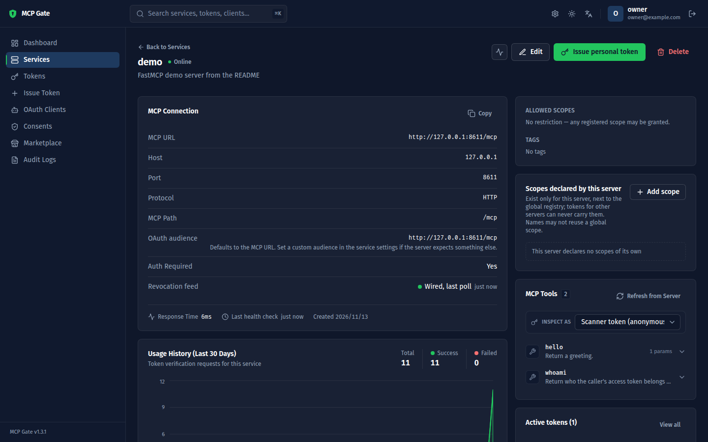

# MCP Gate

[](LICENSE)
[](https://github.com/xianhong1208/MCP_Gate/actions/workflows/ci.yml)
[](https://github.com/xianhong1208/MCP_Gate/releases/latest)

**替你自己架的 MCP server 管登入、token 與管理台:專為 Model Context Protocol 打造的開源 OAuth 2.1 授權伺服器。**

[English](README.md) · [參考資料](docs/reference.zh-TW.md) · [部署](docs/deploy.md) · [發展路線圖](ROADMAP.zh-TW.md) · [變更紀錄](CHANGELOG.md)



MCP Gate 把標準化的身分驗證放在你每一台 MCP server 前面。[FastMCP](https://gofastmcp.com) server 加幾行就受到保護;Claude Code、Claude Desktop、Cursor 這類 MCP client 直接用它們內建的 OAuth 流程連上,腳本則用 personal access token。server 拿 MCP Gate 的公鑰在本地驗 token,MCP Gate 不在請求路徑上。

## 最新消息

**1.3.1**(2026-11-09):從同意頁登入後會回到原本的授權請求,兩個服務也不能再共用同一個 audience。1.3.0 為第一位擁有者加上一次性設定碼,並在 CI 加入相依套件稽核。各版本內容見[變更紀錄](CHANGELOG.md),接下來的方向見[發展路線圖](ROADMAP.zh-TW.md)。

## 主要特色

- **標準化的授權伺服器。** 涵蓋 [MCP 規範](https://modelcontextprotocol.io/specification/2025-06-18/basic/authorization)的授權部分:RFC 8414 metadata、RFC 7591 動態註冊、Client ID Metadata Documents(MCP 2026-07-28 的註冊方式)、authorization code + PKCE、refresh token 輪替與重放偵測、RFC 7009 撤銷、RFC 7662 內省、RFC 8707 resource indicator、RFC 9207 `iss`,以及 `private_key_jwt` client 驗證。
- **離線驗證。** RS256 token 綁定每台 server 的 audience,給 A 的 token 永遠不能打 B。server 只抓一次 JWKS,之後在本地驗證。
- **撤銷也傳得到離線驗證的 server。** server 輪詢撤銷清單,幾秒內就拒絕已撤銷的 token(PAT 也算在內),不必每個請求都問 MCP Gate。
- **同意頁**:自行註冊的 client 第一次連線要你按允許,可依 client 與 server 記住決定。
- **Personal access token(PAT)**:給腳本、CI 與不會走 OAuth 的 client,附可直接貼上的 `claude mcp add` 與 `mcpServers` 片段。
- **服務登錄。** 手動登記或掃描 MCP server、同步工具清單、監看健康狀態,還能用某張 token 的身分查看它看得到的工具(「Inspect as」)。
- **Marketplace 與 orchestrator。** 從 catalog 部署 MCP server,或貼一段 `{command, args, env}`,由 MCP Gate 掛上 HTTP bridge,跑在 Docker 或本機行程裡。
- **零設定啟動。** 預設 SQLite、首次啟動自動產生密鑰、在瀏覽器裡建立擁有者帳號;換 PostgreSQL 只要一個環境變數。管理台有英文與繁體中文。

## 安裝

需要 Python 3.11 以上與 [uv](https://docs.astral.sh/uv/)。只有 Marketplace 需要 Docker。

```bash
git clone https://github.com/xianhong1208/MCP_Gate.git
cd MCP_Gate
uv sync
cp .env.example .env      # 可省略:所有設定都有可用的預設值
uv run python main.py
```

啟動 log 會告訴你每樣東西在哪裡:

```
  Version:    1.3.1
  Address:    http://0.0.0.0:4568
  Issuer:     http://localhost:4568
  Database:   sqlite:///data/mcp_center.db
  Metadata:   http://localhost:4568/.well-known/oauth-authorization-server
  JWKS:       http://localhost:4568/.well-known/jwks.json
  No admin account yet → open http://localhost:4568/setup to create the owner
  Setup token: 7Qw…  (also in data/secrets.json as SETUP_TOKEN; it stops working once the owner exists)
```

打開 <http://localhost:4568/setup>,貼上 log 裡的**設定碼**並建立擁有者帳號。(也可以在第一次啟動前設好 `ADMIN_EMAIL` 與 `ADMIN_PASSWORD`。)

> **不是跑在 `localhost`?** 在簽發任何 token 之前,先把 `OAUTH_ISSUER` 設成公開網址(例如 `https://mcp.example.com`)。它會寫進每張 token,之後再改會讓所有 token 失效。見[部署](docs/deploy.md)。

## 快速開始

以下示範用 MCP Gate 保護一台 FastMCP server、用 personal access token 呼叫它,並開啟撤銷清單。假設 MCP Gate 在 `http://localhost:4568`,server 在 `http://127.0.0.1:8000/mcp`。

### 1. 登記 server

在管理台打開 **Services → Register Service**,輸入 host `127.0.0.1`、port `8000`、path `/mcp`。server 的 **audience**(token 對哪個網址有效)預設就是它的 MCP URL:`http://127.0.0.1:8000/mcp`。一定要先登記:MCP Gate 只替它認得的 audience 簽 token。

### 2. (選用)為撤銷清單登記 client

離線驗證的 server 單靠自己,會一直接受已撤銷的 token,直到它過期。要讓它在幾秒內拒絕,打開 **OAuth Clients → Register trusted client**,選:

- grant type 只勾 `client_credentials`,不填 redirect URI;
- 驗證方式 *Client secret*;
- **Resource server for**:步驟 1 登記的 server。

記下 client id 與 secret(secret 只顯示一次)。跳過這一步,下面的範例也能跑,只是沒有撤銷清單。

### 3. 寫 server

把 [`examples/mcp_gate_hooks.py`](examples/mcp_gate_hooks.py) 複製到 server 旁邊。裡面是 `MCPGateVerifier`:FastMCP 的 `JWTVerifier` 再加上撤銷清單與使用回報,只需要 `fastmcp` 和 `httpx`。接著把下面這段存成 `server.py`(就是 [`examples/fastmcp_server_hooks.py`](examples/fastmcp_server_hooks.py)):

```python
"""A FastMCP server protected by MCP Gate, with the revocation feed.

Every request must carry an access token issued by MCP Gate for this server's audience. Tokens are verified
offline against MCP Gate's JWKS; MCP Gate is never on the request path. When a resource-server client is
configured (MCP_GATE_CLIENT_ID / MCP_GATE_CLIENT_SECRET), MCPGateVerifier also polls MCP Gate's revocation
feed, so a revoked token is refused within `poll_interval` seconds, and reports token usage to the console.

    pip install fastmcp httpx          # or: uv add fastmcp httpx
    cp examples/mcp_gate_hooks.py .    # MCPGateVerifier lives in that single file
    MCP_GATE_URL=http://localhost:4568 python server.py

Before starting it, register the server in the MCP Gate console (Services -> Register Service: host
127.0.0.1, port 8000, path /mcp), so its audience is http://127.0.0.1:8000/mcp. For the revocation feed,
also register a confidential client with grant type client_credentials and "Resource server for" set to
this server, and export its id and secret. See the README's Quick start.
"""

import os

from fastmcp import FastMCP
from fastmcp.server.auth import RemoteAuthProvider
from fastmcp.server.auth.providers.jwt import JWTVerifier
from fastmcp.server.dependencies import get_access_token

from mcp_gate_hooks import MCPGateVerifier

MCP_GATE = os.environ.get("MCP_GATE_URL", "http://localhost:4568").rstrip("/")  # MCP Gate's OAUTH_ISSUER
HOST = os.environ.get("MCP_HOST", "127.0.0.1")
PORT = int(os.environ.get("MCP_PORT", "8000"))
BASE_URL = f"http://{HOST}:{PORT}"
AUDIENCE = os.environ.get("MCP_AUDIENCE", f"{BASE_URL}/mcp")  # must equal the audience shown in the console

verifier_settings = dict(
    jwks_uri=f"{MCP_GATE}/.well-known/jwks.json",
    issuer=MCP_GATE,
    audience=AUDIENCE,
    required_scopes=["mcp:tools:invoke"],
)

if os.environ.get("MCP_GATE_CLIENT_ID"):
    # Offline verification plus the revocation feed and usage reports.
    verifier = MCPGateVerifier(
        **verifier_settings,
        client_id=os.environ["MCP_GATE_CLIENT_ID"],
        client_secret=os.environ["MCP_GATE_CLIENT_SECRET"],
        poll_interval=15,   # seconds between revocation-feed polls
        flush_interval=30,  # seconds between usage reports
    )
else:
    # Offline verification only: a revoked token keeps working until it expires.
    verifier = JWTVerifier(**verifier_settings)

auth = RemoteAuthProvider(
    token_verifier=verifier,
    authorization_servers=[MCP_GATE],  # served at /.well-known/oauth-protected-resource for OAuth clients
    base_url=BASE_URL,
)

mcp = FastMCP(name="demo", instructions="A demo server protected by MCP Gate", auth=auth)


@mcp.tool
def hello(name: str) -> str:
    """Return a greeting."""
    return f"Hello, {name}!"


@mcp.tool
def whoami() -> dict:
    """Return who the caller's access token belongs to."""
    token = get_access_token()
    return {
        "subject": token.subject if token else None,
        "client_id": token.client_id if token else None,
        "scopes": token.scopes if token else [],
    }


if __name__ == "__main__":
    revocation = "on" if isinstance(verifier, MCPGateVerifier) else "off"
    print(f"MCP Gate: {MCP_GATE}   audience: {AUDIENCE}   revocation feed: {revocation}")
    mcp.run(transport="http", host=HOST, port=PORT)
```

### 4. 執行

```bash
pip install fastmcp httpx                    # 或:uv add fastmcp httpx
export MCP_GATE_URL=http://localhost:4568    # MCP Gate 的 OAUTH_ISSUER
export MCP_GATE_CLIENT_ID=mcpc_…             # 步驟 2 拿到的;兩個都不設就不開撤銷清單
export MCP_GATE_CLIENT_SECRET=…
python server.py
```

它會印出 `MCP Gate: http://localhost:4568   audience: http://127.0.0.1:8000/mcp   revocation feed: on`。幾秒內,管理台上這台 server 的頁面就會顯示 **Revocation feed: Wired**。

### 5. 用 personal access token 呼叫

在管理台打開 **Issue Token**,選這台 server、填一個標籤,複製 token(只顯示一次)。然後:

```python
import asyncio
import os

from fastmcp import Client
from fastmcp.client.auth import BearerAuth


async def main():
    pat = os.environ["MCP_GATE_PAT"]  # a personal access token issued for this server
    async with Client("http://127.0.0.1:8000/mcp", auth=BearerAuth(pat)) as client:
        print([tool.name for tool in await client.list_tools()])
        print((await client.call_tool("hello", {"name": "MCP Gate"})).data)
        print((await client.call_tool("whoami", {})).data)


asyncio.run(main())
```

```
['hello', 'whoami']
Hello, MCP Gate!
{'subject': '…', 'client_id': 'mcp-center-console', 'scopes': ['mcp:prompts:read', 'mcp:resources:read', 'mcp:tools:invoke', 'mcp:tools:read']}
```

不帶 token,server 會回 `401`,並把 client 指向 MCP Gate:

```bash
curl -i -X POST http://127.0.0.1:8000/mcp \
  -H 'Content-Type: application/json' -H 'Accept: application/json, text/event-stream' \
  -d '{"jsonrpc":"2.0","id":1,"method":"tools/list"}'
# HTTP/1.1 401 Unauthorized
# www-authenticate: Bearer scope="mcp:tools:invoke", resource_metadata="http://127.0.0.1:8000/.well-known/oauth-protected-resource/mcp"
```

在管理台撤銷這張 token(**Tokens → Revoke**);開著撤銷清單時,下一次呼叫會在一個輪詢週期內被拒絕(範例是 15 秒)。

### 6. 連上 MCP client

支援 OAuth 的 client 什麼都不用先做。第一次使用時,它會向 MCP Gate 註冊,並在瀏覽器開啟同意頁:

```bash
claude mcp add --transport http demo http://127.0.0.1:8000/mcp
```

不支援 OAuth 的 client 把 personal access token 當標頭帶上:

```bash
claude mcp add --transport http demo http://127.0.0.1:8000/mcp \
  --header "Authorization: Bearer <PERSONAL_ACCESS_TOKEN>"
```

每台 server 頁面上的 **Integration** 面板,會依那台 server 的網址與 audience 產生這些片段,以及 server 程式碼。

## 運作原理

```
┌──────────────────────┐   ① 401 + protected-resource metadata   ┌──────────────────────┐
│      MCP client      │ ───────────────────────────────────────▶ │  你的 FastMCP server  │
│ Claude Code / Cursor │ ◀─────────────────────────────────────── │   (resource server)   │
│  Claude Desktop / …  │   ⑤ Authorization: Bearer <JWT>          │                      │
└──────────┬───────────┘                                          └──────────┬───────────┘
           │ ② discovery + dynamic client registration                       │ ④ 抓一次 JWKS,
           │ ③ authorize (PKCE) → consent → code → token                     │    離線驗證;
           ▼                                                                 ▼    輪詢撤銷清單
┌──────────────────────────────────────────────────────────────────────────────────────────┐
│  MCP Gate — OAuth 2.1 authorization server + console                                    │
│  /.well-known/oauth-authorization-server   /.well-known/jwks.json   /oauth/revoked       │
│  /oauth/register  /oauth/authorize  /oauth/token  /oauth/revoke  /oauth/introspect       │
└──────────────────────────────────────────────────────────────────────────────────────────┘
```

MCP Gate 是**授權伺服器**;你的 MCP server 是 **resource server**,只驗證 token、從不簽發。每個步驟、token 內容、所有設定、Client ID Metadata Documents、撤銷清單、管理台各頁與 HTTP API,都在[參考資料](docs/reference.zh-TW.md)裡。

## 部署方式

| 在哪裡 | 怎麼做 |
|---|---|
| 自己的電腦 | `uv run python main.py`,SQLite 放在 `data/`。預設 issuer 是 `http://localhost:4568`。 |
| 伺服器,走 HTTPS | 前面放反向代理(nginx 或 Caddy),`OAUTH_ISSUER` 設成公開網址,`SECURE_COOKIE=true`:見[部署](docs/deploy.md)。 |
| PostgreSQL | `uv sync --extra postgres`,再設 `DATABASE_URL=postgresql://…`。每次啟動都會跑 migration。 |

官方 Docker image 排在 1.4(見[發展路線圖](ROADMAP.zh-TW.md))。

## 文件

- [參考資料](docs/reference.zh-TW.md):運作原理、設定、撤銷清單、管理台、API
- [反向代理與 HTTPS 部署](docs/deploy.md)
- [疑難排解](docs/troubleshooting.md)
- [架構](docs/architecture.md)
- [安全政策](SECURITY.md)
- [發展路線圖](ROADMAP.zh-TW.md) · [變更紀錄](CHANGELOG.md)

(部署、疑難排解、架構、安全政策與變更紀錄只有英文版。)

## 貢獻

歡迎開 issue 與 pull request。開發環境、CI 跑的檢查、分層規則與發布步驟見 [CONTRIBUTING.md](CONTRIBUTING.md)。

## 授權

[MIT](LICENSE)
